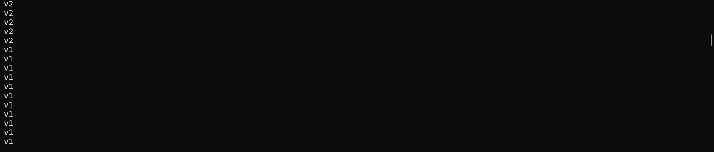
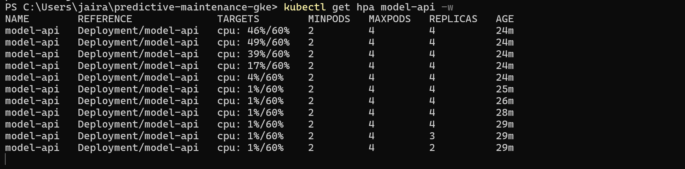
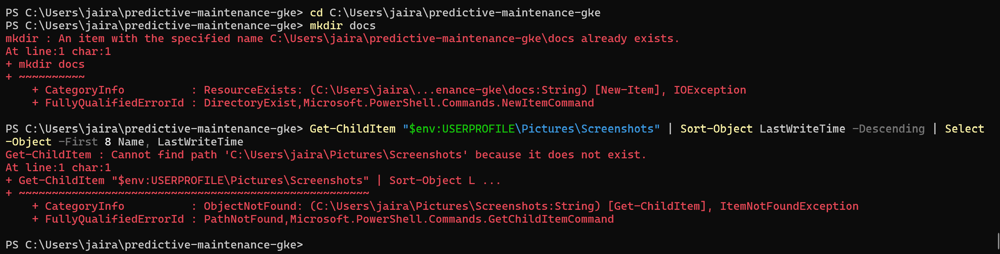

# Predictive Maintenance API on Google Kubernetes Engine

The predictive maintenance model from my [Cloud Run lab](https://github.com/jaira26/predictive-maintenance-cloudrun), redeployed on Google Kubernetes Engine (GKE) Autopilot with health probes, zero-downtime rolling updates, rollback, and CPU-based autoscaling.

Built for the Kubernetes lab of the MLOps course at Northeastern University. It reuses the exact container image from the Cloud Run lab (Artifact Registry), so the comparison between the two platforms is apples to apples.

## What this lab adds

- **Deployment** with 2 replicas, readiness and liveness probes on `/health`, and fixed resource requests and limits
- **LoadBalancer Service** exposing the API on port 80
- **Horizontal Pod Autoscaler** scaling between 2 and 4 replicas at 60% CPU
- **Zero-downtime rolling update** from v1 to v2, plus a rollback
- **In-cluster load test** demonstrating scale-up and scale-down
- **Cloud Run vs GKE comparison** based on running the same image on both

## Architecture

~~~
Artifact Registry (model-api:v1, v2)
        |
GKE Autopilot cluster (us-east1)
        |
Deployment: model-api (2-4 pods, probes on /health)
        |
Service: LoadBalancer (port 80 -> container 8080)
        |
HPA: scales on CPU (target 60%)
~~~

## The model

A random forest predicting machine failure from sensor readings (AI4I 2020 dataset), with physics-based engineered features (power, strain, temperature difference). Failure-class results: precision 0.95, recall 0.82, F1 0.88. Full details on the model, features, and API are in the [Cloud Run repo](https://github.com/jaira26/predictive-maintenance-cloudrun).

Endpoints: `GET /health`, `GET /model-info`, `POST /predict`, `GET /docs`.

## Kubernetes manifests

| File | Purpose |
|---|---|
| `k8s/deployment.yaml` | 2 replicas, rolling update strategy, probes, resources |
| `k8s/service.yaml` | External LoadBalancer |
| `k8s/hpa.yaml` | CPU autoscaling, 2 to 4 replicas |
| `loadtest/load-generator.yaml` | In-cluster load test pod (kept separate so it never deploys by accident) |

Key settings:

- **Readiness probe:** a pod receives no traffic until `/health` responds. On first deploy, pods showed `Running 0/1` for about 30 seconds before becoming `1/1` and receiving traffic.
- **Liveness probe:** Kubernetes restarts a pod if `/health` stops responding.
- **`maxUnavailable: 0`, `maxSurge: 1`:** during updates, a new pod must be ready before an old one is removed.
- **Requests equal to limits (250m CPU, 512Mi):** Autopilot bills on requests, so this keeps cost predictable.

## Results

### Rolling update (v1 to v2)

v2 adds a `version` field to `/health` and `/model-info`. A monitor polled `/health` twice per second during the rollout. Traffic switched from v1 to v2 with no failed requests: the monitor never returned an error. The rollout log confirms the order: one new replica came up before any old replica terminated.

### Rollback

`kubectl rollout undo` reverted to v1 with no failed requests, without rebuilding anything. The manifest was then re-applied to return to v2, so the cluster matches the repo.

### Autoscaling

An in-cluster load generator ran 8 parallel request loops against `/predict` through the Service's internal DNS name.

| CPU (target 60%) | Replicas | What happened |
|---|---|---|
| 1% | 2 | Idle baseline |
| 64% | 2 | No scaling: within the HPA's 10% tolerance band |
| 70% | 3 | First scale-up |
| 67% | 4 | Second scale-up, reached maxReplicas |
| 1% (load stopped) | 4 | Held during the scale-down stabilization window |
| 1% | 3, then 2 | Stepped down to minReplicas about 5 minutes after load stopped |

Two behaviors worth noting. The HPA did not react the instant CPU crossed 60%: its default 10% tolerance prevents scaling on small fluctuations. And scale-down is deliberately slower than scale-up, so the deployment does not flap if traffic returns.

Load test limitation: CPU stayed near 67% even at 4 replicas, likely because the single load generator pod (250m CPU) was itself the bottleneck. A distributed load test would push the service harder.

## Cloud Run vs GKE

Same image, same model, two platforms:

| | Cloud Run | GKE Autopilot |
|---|---|---|
| Scaling | Request-based, scales to zero | HPA on CPU, minimum 2 pods |
| Idle cost | Zero | Pods and load balancer billed continuously |
| Cold starts | Yes, after idle periods | No, minimum replicas stay warm |
| Deploy effort | One command | Manifests for deployment, service, autoscaler |
| Control | Limited | Full: probes, rollout strategy, resources, scheduling |
| Rollback | Shift traffic to a previous revision | `kubectl rollout undo` |
| HTTPS | Automatic | Plain HTTP unless an Ingress and certificate are added |

**When to use which:** Cloud Run fits a single stateless service with spiky or low traffic, where scale-to-zero and zero operations matter most. GKE fits when you run many services together, have steady traffic, or need control over rollouts, probes, scheduling, or networking.

## Reproduce

Prerequisites: gcloud CLI with `kubectl` and `gke-gcloud-auth-plugin`, a GCP project with billing, and the image in Artifact Registry (see the Cloud Run repo).

~~~
gcloud services enable container.googleapis.com
gcloud container clusters create-auto pm-cluster --region us-east1
gcloud container clusters get-credentials pm-cluster --region us-east1

kubectl apply -f k8s/
kubectl get pods
kubectl get svc model-api
~~~

Rolling update and rollback:

~~~
kubectl apply -f k8s/deployment.yaml
kubectl rollout status deployment/model-api
kubectl rollout history deployment/model-api
kubectl rollout undo deployment/model-api
~~~

Load test:

~~~
kubectl apply -f loadtest/load-generator.yaml
kubectl get hpa model-api -w
kubectl delete pod load-generator
~~~

Cleanup (the cluster bills while it exists):

~~~
kubectl delete -f k8s/
gcloud container clusters delete pm-cluster --region us-east1
~~~

The cluster has been deleted after the lab to stop billing, so there is no live endpoint for this repo. The [Cloud Run deployment](https://model-api-633970234530.us-east1.run.app/docs) of the same model remains live.

## Author

Jairaghavendra Sridhar, MS Data Analytics Engineering, Northeastern University
[GitHub](https://github.com/jaira26) | [LinkedIn](https://www.linkedin.com/in/jairaghavendrasridhar26)
